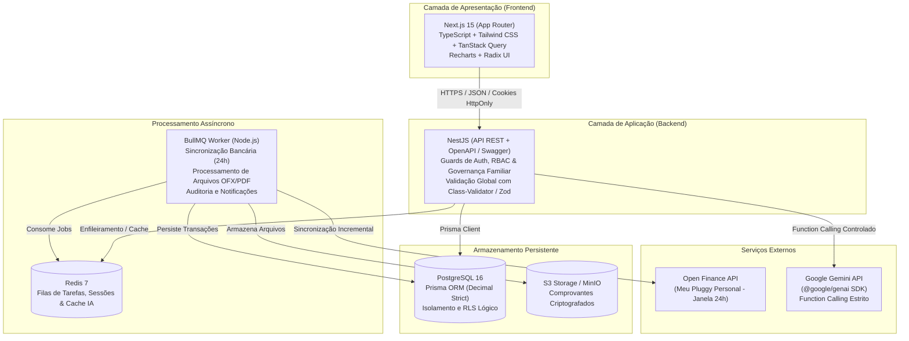

# FINN AI — Visão Geral da Arquitetura do Sistema

## 1. Topologia e Visão Sistêmica

O FINN AI é projetado como um sistema modular de alto desempenho, focado em isolamento de dados familiares, estabilidade operacional e custo mínimo de infraestrutura.

---

## 2. Princípios de Engenharia

1. **Desacoplamento e Abstração de Terceiros:**
   Nenhuma regra de negócio financeira depende diretamente do SDK da Pluggy ou do Gemini. O módulo financeiro interage com a interface interna `BankingProvider` e o agente de IA interage com serviços REST/Domínio bem definidos.
2. **Precisão Monetária Absoluta:**
   É terminantemente proibido o uso de `float` ou `double` para valores financeiros. O sistema adota `Prisma.Decimal` (armazenado como `DECIMAL(14, 2)` ou `DECIMAL(18, 4)`) em todas as operações de balanço, saldo e conciliação.
3. **Isolamento de Titularidade e Governança Familiar:**
   A existência de um `Household` (núcleo familiar compartilhado) não concede direito de visualização cega de dados entre cônjuges. O acesso é governado pela tabela `sharing_permissions`, que valida expressamente se o cônjuge tem permissão de leitura sobre a conta bancária ou cartão específico.
4. **Segurança de Ações da IA em Duas Etapas:**
   O agente FINN nunca executa comandos de mutação direta no banco de dados via Function Calling sem apresentar um `Draft` (rascunho estruturado) ao usuário com botão de confirmação humana explícita.
5. **Zero Vulnerabilidade de Prompt Injection:**
   O modelo Gemini nunca recebe acesso a comandos SQL ou shell. Suas ferramentas recebem apenas parâmetros tipados e sanitizados validados pelos DTOs do NestJS.

---

## 3. Módulos do Backend NestJS

O backend é organizado na pasta `apps/api/src/modules/` em módulos desacoplados:

| Módulo | Responsabilidade |
| :--- | :--- |
| `auth` | Registro, login, hash de senha seguro, emissão de tokens/cookies e sessões |
| `users` | Gestão de perfil, preferências de privacidade e histórico de sessões |
| `households` | Gestão do núcleo familiar, fluxo de convites e membros |
| `permissions` | Guardiões de autorização granular e controle de compartilhamento seletivo |
| `banking` | Orquestração do provedor bancário (`BankingProvider`), agendamentos de sincronização e conciliação |
| `accounts` | Contas correntes, investimentos, carteiras físicas e saldos conciliados |
| `transactions` | Lançamentos de receitas, despesas, conciliação e deduplicação |
| `transfers` | Transferências entre contas e transferências entre membros do casal |
| `categories` | Categorização hierárquica e regras de auto-classificação |
| `credit-cards` | Cartões de crédito, limites, datas de corte e vencimento de faturas |
| `credit-card-bills`| Faturas de cartão, compras parceladas e pagamento consolidado |
| `budgets` | Orçamentos por categoria, limites mensais e alertas de consumo |
| `goals` | Metas financeiras individuais e familiares, histórico de aportes e projeções |
| `documents` | Armazenamento seguro de extratos e comprovantes fiscais |
| `imports` | Processamento de arquivos OFX, CSV, PDF e OCR de comprovantes com pré-visualização |
| `ai-agent` | Orquestração com `@google/genai`, Function Calling, memória controlada e auditoria |
| `notifications` | Notificações no app e alertas de vencimento |
| `reports` | Geração de métricas consolidadas de fluxo de caixa e demonstrativos |
| `audit` | Registro imutável de ações sensíveis e consentimentos LGPD |

