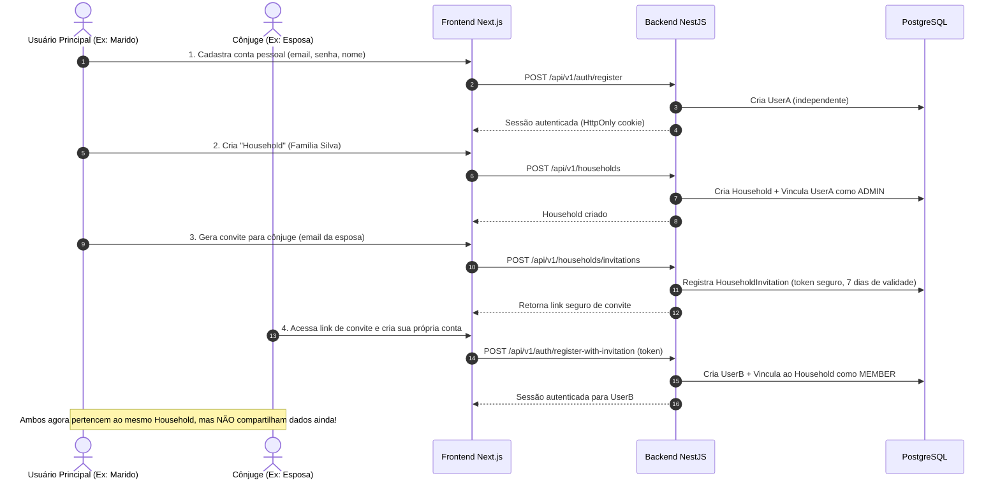

# FINN AI — Fluxos de Usuário, Governança e Dinâmica Familiar

## 1. Princípios do Núcleo Familiar (Household)

O FINN AI foi concebido para atender à realidade de famílias modernas, especificamente um casal onde cada indivíduo possui sua vida financeira independente (contas próprias, cartões próprios, receitas de trabalho) e áreas de convivência compartilhada (despesas da casa, metas conjuntas, investimentos futuros).

### Regra de Ouro da Privacidade
> **Estar na mesma família NÃO confere visibilidade irrestrita das finanças do cônjuge.**  
> Cada conta bancária, cartão de crédito e transação possui um titular primário (`ownerId`). A visibilidade para o cônjuge depende exclusivamente de autorização expressa registrada na tabela de permissões de compartilhamento.

---

## 2. Fluxo de Onboarding e Criação da Família

---

## 3. Matriz de Permissões e Compartilhamento Seletivo

Cada recurso financeiro pode operar em três níveis de privacidade:

| Nível de Privacidade | Titular (`ownerId`) | Cônjuge no Household | Impacto no Dashboard Familiar |
| :--- | :--- | :--- | :--- |
| **Privado / Individual** | Leitura e Escrita total | Invisível (sem acesso) | Os valores **não** entram no cálculo familiar |
| **Compartilhado (Somente Leitura)** | Leitura e Escrita total | Visualização de saldo e transações | Soma nos totais consolidados da família |
| **Conjunto / Co-gerenciado** | Leitura e Escrita | Leitura e Escrita autorizada | Soma nos totais e permite anotações/tags conjuntas |

### Configuração de Compartilhamento por Entidade
- **Contas Bancárias:** Titular escolhe `ISOLATED` (padrão) ou `SHARED_WITH_HOUSEHOLD`.
- **Cartões de Crédito:** Titular escolhe se o cônjuge pode visualizar o limite e as faturas.
- **Transações Específicas:** Uma transação pode receber a tag de privacidade pessoal, ocultando sua descrição detalhada se o titular desejar, mantendo apenas a categoria agregada.
- **Metas:** Podem ser individuais (ex: "Troca do meu celular") ou do casal (ex: "Entrada do Apartamento", "Viagem de Férias").

---

## 4. Tratamento de Transferências e Não-Duplicação de Renda Familiar

Um dos erros mais comuns em gerenciadores financeiros é contar transferências entre contas como receita ou despesa duplicada. No FINN AI, isso é resolvido com algoritmos de conciliação:

### Cenário A: Transferência entre contas do mesmo usuário
- Exemplo: Marido transfere R$ 1.000 da Conta Corrente Itaú para a Poupança Itaú.
- **Classificação:** `TRANSFER_INTERNAL`.
- **Impacto no Dashboard Individual:** Variação de saldo nula no fluxo de caixa (não é receita nem despesa).
- **Impacto no Dashboard Familiar:** Variação de saldo nula.

### Cenário B: Transferência entre os cônjuges (Divisão de contas)
- Exemplo: Esposa envia R$ 1.500 via Pix para o Marido pagar o aluguel do mês.
- **Na visão individual da Esposa:** Saída de R$ 1.500 (despesa ou repasse familiar).
- **Na visão individual do Marido:** Entrada de R$ 1.500 (repasse recebido).
- **Na visão CONSOLIDADA DA FAMÍLIA:** O repasse de R$ 1.500 é neutralizado (`TRANSFER_HOUSEHOLD_INTERNAL`). Apenas o pagamento final do aluguel (R$ 3.000 para a imobiliária) é contabilizado como despesa real da família, **evitando que a despesa ou receita seja inflada para R$ 4.500**.

### Cenário C: Pagamento de Fatura de Cartão de Crédito
- Compras no cartão são contabilizadas no momento da compra (regime de competência).
- O pagamento da fatura bancária no débito em conta é classificado como `CREDIT_CARD_PAYMENT_TRANSFER`, dando baixa na fatura sem duplicar as despesas individuais já lançadas.

