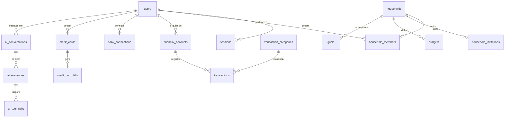

# FINN AI — Especificação do Modelo de Dados PostgreSQL

## 1. Visão Geral e Convenções

O banco de dados relacional PostgreSQL do FINN AI foi modelado para garantir **integridade referencial estrita**, **alta velocidade de consulta** para séries temporais financeiras e **precisão monetária decimal absoluta**.

### Convenções do Banco:
- **Identificadores:** UUID v4 para todas as entidades principais.
- **Tipos Monetários:** `DECIMAL(14, 2)` para valores financeiros correntes (R$ 999.999.999.999,99) e `DECIMAL(18, 4)` para taxas e conversões. **É proibido o uso de `FLOAT` ou `DOUBLE PRECISION`**.
- **Datas:** `TIMESTAMP WITH TIME ZONE` (armazenado em UTC).
- **Nomenclatura no Banco:** `snake_case` para tabelas e colunas; `camelCase` nas entidades Prisma.
- **Isolamento Lógico:** Todo recurso com titularidade individual possui chave estrangeira `user_id` e, quando aplicável, `household_id`.

---

## 2. Mapa das Entidades Principais

---

## 3. Dicionário das 40 Entidades Essenciais

1. `users`: Contas de usuários individuais (email, senha com Argon2, nome, status, flags).
2. `sessions`: Sessões ativas de login com token hash, IP, user-agent e expiração.
3. `households`: Núcleos familiares que agrupam membros para visão consolidada.
4. `household_members`: Associação N:N entre usuários e famílias com papéis (`ADMIN`, `MEMBER`).
5. `household_invitations`: Convites pendentes por e-mail com token criptografado e validade.
6. `permissions`: Permissões globais e permissões de sistema.
7. `sharing_permissions`: Permissões granulares de compartilhamento de contas/cartões entre cônjuges.
8. `financial_accounts`: Contas bancárias, carteiras físicas e investimentos.
9. `bank_connections`: Vínculo da instituição bancária (Meu Pluggy).
10. `bank_connection_items`: Registro de itens (`itemId`) autorizados no Meu Pluggy.
11. `bank_sync_jobs`: Tarefas de sincronização em segundo plano enfileiradas no BullMQ.
12. `bank_sync_history`: Histórico de execuções de sincronização com logs de status e erros.
13. `transactions`: Lançamentos financeiros (receitas, despesas, transferências).
14. `transaction_categories`: Categorias e subcategorias com regras de classificação.
15. `transaction_tags`: Etiquetas adicionais (ex: "Férias", "Reforma", "Trabalho").
16. `transaction_tag_links`: Relação N:N entre transações e tags.
17. `transaction_splits`: Divisão de uma transação em múltiplas categorias.
18. `transfers`: Conciliação de transferências entre contas e entre cônjuges.
19. `credit_cards`: Cartões de crédito, limites, dias de fechamento e vencimento.
20. `credit_card_bills`: Faturas mensais de cartão de crédito e status de pagamento.
21. `installments`: Compras parceladas com controle de competência e vencimento.
22. `recurring_transactions`: Assinaturas e despesas fixas recorrentes.
23. `budgets`: Orçamentos de gastos por categoria e período.
24. `budget_periods`: Ciclos mensais de acompanhamento de orçamento.
25. `goals`: Metas de economia e patrimônio (individuais ou do casal).
26. `goal_contributions`: Histórico de aportes realizados para uma meta.
27. `financial_plans`: Planos de médio/longo prazo para a família.
28. `financial_scenarios`: Simulações de cenários (otimista, realista, pessimista).
29. `documents`: Arquivos armazenados no S3 (comprovantes, extratos, faturas).
30. `document_extractions`: Dados estruturados extraídos de documentos via OCR/IA.
31. `import_batches`: Lotes de importação de arquivos (OFX, CSV).
32. `import_rows`: Linhas individuais importadas com prévia e deduplicação.
33. `ai_conversations`: Conversas com o agente FINN.
34. `ai_messages`: Mensagens do usuário e do agente FINN com papéis (`USER`, `ASSISTANT`, `SYSTEM`).
35. `ai_tool_calls`: Registro das ferramentas executadas pelo Gemini com parâmetros e resultados.
36. `ai_preferences`: Preferências financeiras aprendidas pela IA e autorizadas pelo usuário.
37. `notifications`: Notificações do sistema (avisos de fatura, estouro de orçamento, sync).
38. `audit_logs`: Trilhas de auditoria para ações financeiras e administrativas.
39. `user_consents`: Registro formal de consentimentos LGPD por usuário.
40. `app_settings`: Configurações do sistema por usuário ou família.

