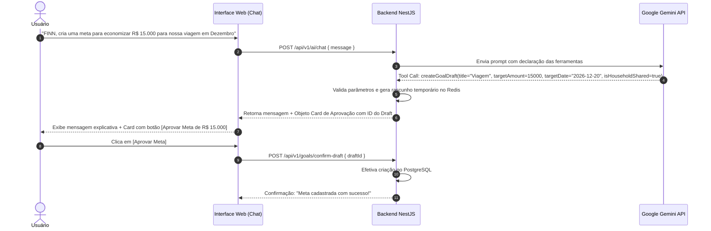

# FINN AI — Especificação do Agente Financeiro com Google Gemini

## 1. Visão Geral do Agente FINN

O **FINN** é um agente financeiro proativo e analítico desenvolvido sobre a API do Google Gemini utilizando o SDK oficial `@google/genai`.

Diferente de um chatbot convencional de texto genérico, o FINN opera como um **Agente Autônomo com Ferramentas (Tool Calling)**, capaz de inspecionar saldos, analisar faturas, calcular desvios de orçamento, simular planos de economia e estruturar rascunhos de metas para o casal.

---

## 2. Princípios Inegociáveis de Segurança

1. **PROIBIÇÃO DE SQL ARBITRÁRIO:** O modelo **NUNCA** gera ou executa código SQL. Toda consulta ou mutação passa por funções tipadas do NestJS com parâmetros estritos e validados por Zod/class-validator.
2. **ISOLAMENTO DE CONTEXTO:** O backend injeta o `userId` e o `householdId` do usuário autenticado no contexto de execução de cada ferramenta. O modelo não tem capacidade de forjar a identidade do usuário.
3. **CONFIRMAÇÃO EM DUAS ETAPAS PARA ESCRITA:** Nenhuma alteração financeira definitiva (criação de meta, ajuste de orçamento, alteração de categoria) é gravada diretamente pela IA. O modelo gera um `Draft` (rascunho estruturado) e a interface apresenta botões de **[Aprovar]** ou **[Descartar]** ao usuário.
4. **LIMITES DE OPERAÇÃO:**
   - 🚫 A IA **NÃO** realiza transferências, Pix ou pagamentos bancários.
   - 🚫 A IA **NÃO** altera senhas ou permissões de compartilhamento.
   - 🚫 A IA **NÃO** apaga registros históricos de transações.

---

## 3. Catálogo de Ferramentas (Function Calling)

O FINN possui um conjunto de ferramentas declaradas via JSON Schema no Gemini:

### Ferramentas de Consulta (Read-Only)
```typescript
/**
 * Retorna resumo financeiro consolidado ou individual para um período especificado.
 */
getFinancialSummary(params: {
  startDate: string; // YYYY-MM-DD
  endDate: string;   // YYYY-MM-DD
  scope: 'PERSONAL' | 'HOUSEHOLD';
}): Promise<FinancialSummaryResult>;

/**
 * Filtra transações financeiras por categoria, tipo ou valor.
 */
getTransactions(params: {
  startDate?: string;
  endDate?: string;
  categoryName?: string;
  type?: 'INCOME' | 'EXPENSE';
  limit?: number;
  scope: 'PERSONAL' | 'HOUSEHOLD';
}): Promise<TransactionListResult>;

/**
 * Analisa despesas agrupadas por categoria e calcula desvios percentuais.
 */
getSpendingByCategory(params: {
  month: number;
  year: number;
  scope: 'PERSONAL' | 'HOUSEHOLD';
}): Promise<CategoryBreakdownResult>;

/**
 * Consulta a situação de metas ativas e projeção de conclusão.
 */
getGoalProgress(params: {
  goalId?: string;
  scope: 'PERSONAL' | 'HOUSEHOLD';
}): Promise<GoalProgressResult>;

/**
 * Simula prazos e aportes para alcance de metas com base em juros/reserva.
 */
simulateSavingsPlan(params: {
  targetAmount: number;
  monthlyDeposit: number;
  annualRatePct?: number; // padrão: 0% conservador / CDI simulado
}): Promise<SavingsSimulationResult>;
```

### Ferramentas de Preparação de Rascunho (Drafting / Ações em 2 Etapas)
```typescript
/**
 * Prepara uma proposta de meta financeira para aprovação do usuário.
 */
createGoalDraft(params: {
  title: string;
  description?: string;
  targetAmount: number;
  targetDate: string; // YYYY-MM-DD
  monthlyContribution?: number;
  isHouseholdShared: boolean;
}): Promise<GoalDraftResponse>;

/**
 * Prepara uma proposta de ajuste de limite de orçamento para categoria.
 */
updateBudgetDraft(params: {
  categoryId: string;
  monthlyLimit: number;
  scope: 'PERSONAL' | 'HOUSEHOLD';
}): Promise<BudgetDraftResponse>;
```

---

## 4. Fluxo de Confirmação em 2 Etapas



---

## 5. Entrada Multimodal (Comprovantes, Áudio e PDFs)

O FINN processa arquivos enviados pelo usuário:
1. **Comprovantes Pix e Boletos:** Extração estruturada (valor, beneficiário, data, chave pix, autenticação bancária).
2. **Extratos em PDF:** Leitura de tabelas e conversão em lote para conferência.
3. **Áudios do Usuário ("Gastei 45 reais na padaria no débito"):** Transcrição e extração de transação avulsa.

---

## 6. Controle de Custos, Cache e Limites de Tokens

- **Modelo Padrão:** `gemini-2.5-flash` (ótima inteligência e relação custo-benefício).
- **Modelo de Contingência/Leve:** `gemini-2.5-flash-lite`.
- **Cache de Resumos:** O resumo de gastos do mês corrente é cacheado no Redis com TTL de 1 hora e invalidado quando uma nova transação é lançada.
- **Limite Diário de Requisições:** Limite padrão de 100 interações de IA por usuário/dia para prevenir consumo descontrolado.

