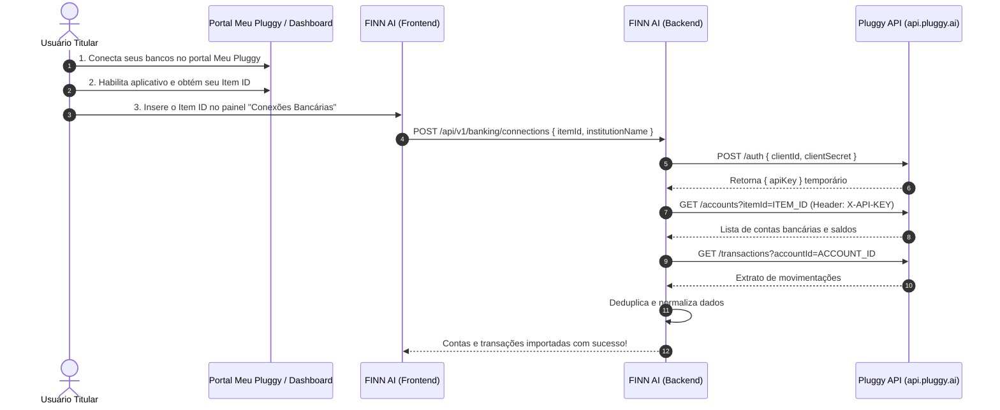

# FINN AI — Especificação da Integração Open Finance (Meu Pluggy)

## 1. Contexto e Modalidade Operacional

O FINN AI utiliza a API da **Pluggy** inicialmente na modalidade **Meu Pluggy (Personal Use)**.

### Características e Limitações Oficiais:
- **Gratuito para uso pessoal:** Adequado para o casal acompanhar suas contas bancárias.
- **Limite de Conexões:** Até 5 instituições financeiras conectadas simultaneamente.
- **Frequência de Atualização:** Os dados bancários são atualizados pelo Meu Pluggy aproximadamente a cada **24 horas**. Forçar chamadas frequentes à API **não** obriga as instituições financeiras a disponibilizarem novas transações.
- **Particularidade do Endpoint de Items:** Na modalidade pessoal do Meu Pluggy, a rota `GET /v2/items` **não está disponível**. Portanto, o FINN AI implementa um fluxo de registro do `itemId` no onboarding da conexão.
- **Validade do Consentimento:** O consentimento Open Finance concedido no Meu Pluggy tem duração típica de até 1 ano (`consentExpiresAt`). O sistema deve monitorar e alertar sobre a necessidade de renovação.

---

## 2. Fluxo de Autorização e Coleta de Dados



---

## 3. Contrato de Abstração: `BankingProvider`

Para garantir que o FINN AI não fique acoplado a nenhum provedor específico, toda a camada de domínio comunica-se com a interface `BankingProvider`:

```typescript
export interface BankAccountDto {
  externalId: string;
  name: string;
  type: 'CHECKING' | 'SAVINGS' | 'CREDIT_CARD' | 'INVESTMENT';
  subtype?: string;
  number?: string;
  balance: number; // convertido com precisão Decimal no repositório
  currencyCode: string;
  updatedAt: Date;
}

export interface BankTransactionDto {
  externalId: string;
  accountId: string;
  description: string;
  amount: number;
  date: Date;
  type: 'DEBIT' | 'CREDIT';
  status: 'PENDING' | 'POSTED';
  category?: string;
  merchantName?: string;
}

export interface TransactionPage {
  transactions: BankTransactionDto[];
  nextCursor?: string;
  hasMore: boolean;
}

export interface ConnectionStatus {
  connectionId: string;
  status: 'ACTIVE' | 'OUTDATED' | 'FAILED' | 'CONSENT_EXPIRED';
  lastSyncAt?: Date;
  consentExpiresAt?: Date;
  errorMessage?: string;
}

export interface BankingProvider {
  authenticate(): Promise<string>;
  getAccounts(connectionId: string): Promise<BankAccountDto[]>;
  getTransactions(accountId: string, cursor?: string): Promise<TransactionPage>;
  getConnectionStatus(connectionId: string): Promise<ConnectionStatus>;
  disconnect(connectionId: string): Promise<void>;
}
```

---

## 4. Estratégia de Deduplicação e Idempotência

Para evitar transações duplicadas em sincronizações sucessivas:
1. **Hash de Idempotência:** É gerado um identificador único composto:
   ```text
   idempotencyKey = sha256(`${accountId}:${externalId || description}:${amount}:${date.toISOString().split('T')[0]}`)
   ```
2. No banco de dados, o campo `transactions.idempotency_key` possui constraint `UNIQUE`.
3. Em caso de colisão, o sistema realiza um `upsert` seguro apenas se o status da transação mudou de `PENDING` para `POSTED`.

---

## 5. Rotinas em Segundo Plano com BullMQ

- **Fila:** `banking-sync-queue`
- **Ciclo:** Execução programada diária (cron job) via BullMQ para checar itens ativos.
- **Tratamento de Rate Limit e Backoff:**
  - Tentativas com backoff exponencial (3 tentativas: 2s, 10s, 60s).
  - Em caso de falha de conexão ou manutenção no banco conveniado, registra o status em `bank_sync_jobs` sem apagar os dados existentes no sistema.
- **Avisos de Consentimento:** Notifica quando `consentExpiresAt` estiver a menos de 30 dias do vencimento.

